<div align="center">


### Pixel-style search for every Android phone: one bar for your apps, contacts, files and the web, a Discover page for your day, and a widget made your way.

[](https://play.google.com/store/apps/details?id=com.pixel.intelligentsearch)
[](https://github.com/Peacetothemountain/Intelligent-Search/releases/latest)

[](https://github.com/Peacetothemountain/Intelligent-Search/actions/workflows/ci.yml)
[](https://developer.android.com/about/versions)
[](https://kotlinlang.org)
[](https://developer.android.com/compose)
[](LICENSE)

<br/>

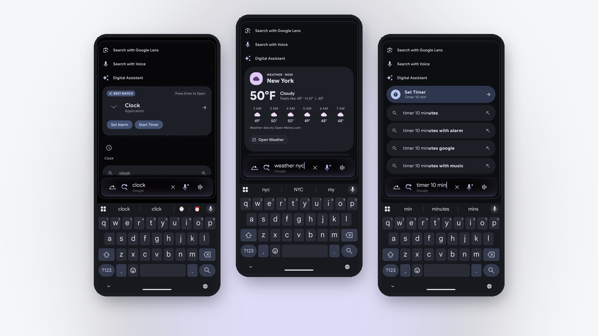

<sub><b>Best match</b> · <b>Instant answers</b> · <b>Quick actions</b></sub>

</div>

---

## Why Intelligent Search

<table>
  <tr>
    <td width="25%" align="center" valign="top"><h3>⚡</h3><b>Instant</b><br/><sub>Answers, conversions and actions appear as you type, matched on your phone.</sub></td>
    <td width="25%" align="center" valign="top"><h3>☀️</h3><b>Your day at a glance</b><br/><sub>Discover lays out your plans, weather, controls and favorite widgets.</sub></td>
    <td width="25%" align="center" valign="top"><h3>🎨</h3><b>Made yours</b><br/><sub>Material You colors, shapes, widgets and icons, down to the last pixel.</sub></td>
    <td width="25%" align="center" valign="top"><h3>🛡️</h3><b>Private by design</b><br/><sub>Matching never leaves the device; backups are encrypted with your passkey or passphrase.</sub></td>
  </tr>
</table>

## 📸 Screenshots

<div align="center">

**Search**

<table>
  <tr>
    <td align="center" valign="top">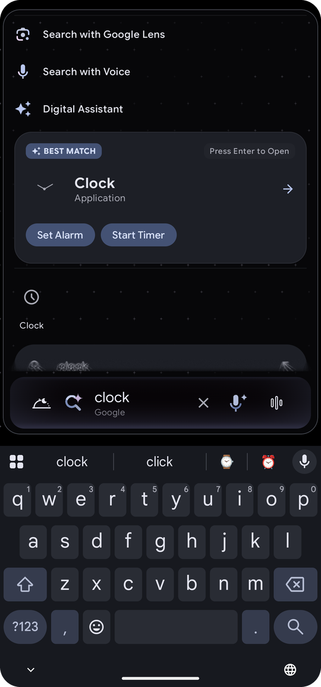<br/><sub><b>Best match</b></sub></td>
    <td align="center" valign="top">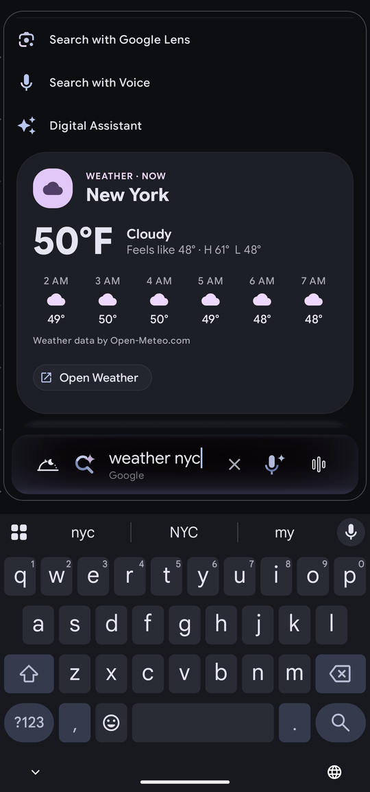<br/><sub><b>Weather</b></sub></td>
    <td align="center" valign="top">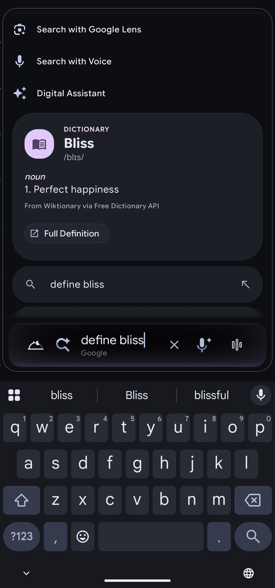<br/><sub><b>Definitions</b></sub></td>
    <td align="center" valign="top">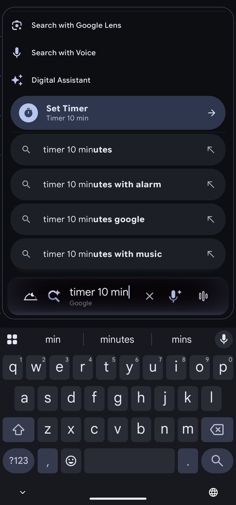<br/><sub><b>Quick actions</b></sub></td>
  </tr>
</table>

**Discover**

<table>
  <tr>
    <td align="center" valign="top">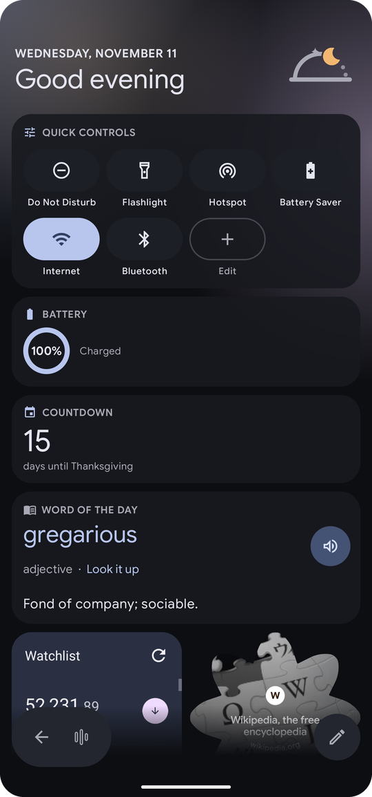<br/><sub><b>Your day</b></sub></td>
    <td align="center" valign="top">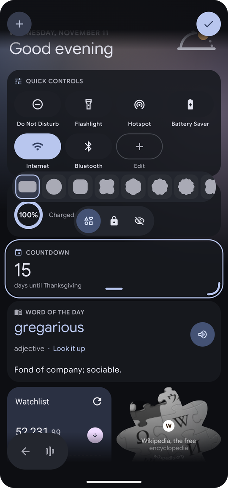<br/><sub><b>Shapes and layout</b></sub></td>
    <td align="center" valign="top">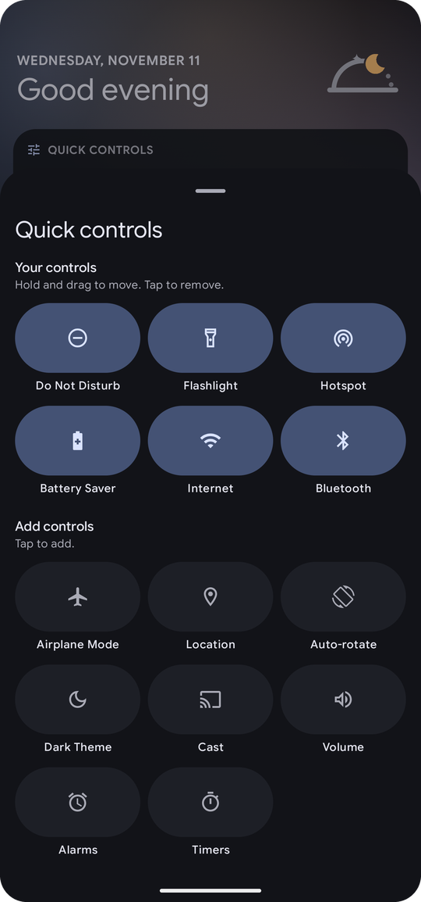<br/><sub><b>Quick controls</b></sub></td>
    <td align="center" valign="top">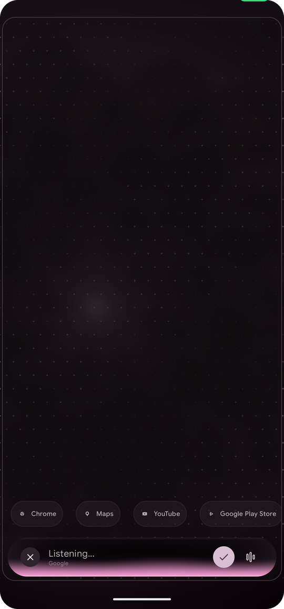<br/><sub><b>Voice search</b></sub></td>
  </tr>
</table>

**Make it yours**

<table>
  <tr>
    <td align="center" valign="top">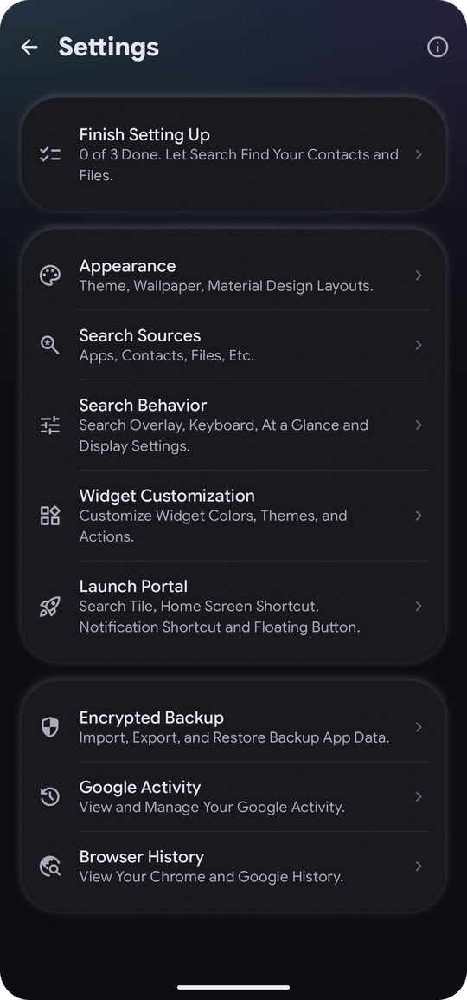<br/><sub><b>Settings</b></sub></td>
    <td align="center" valign="top">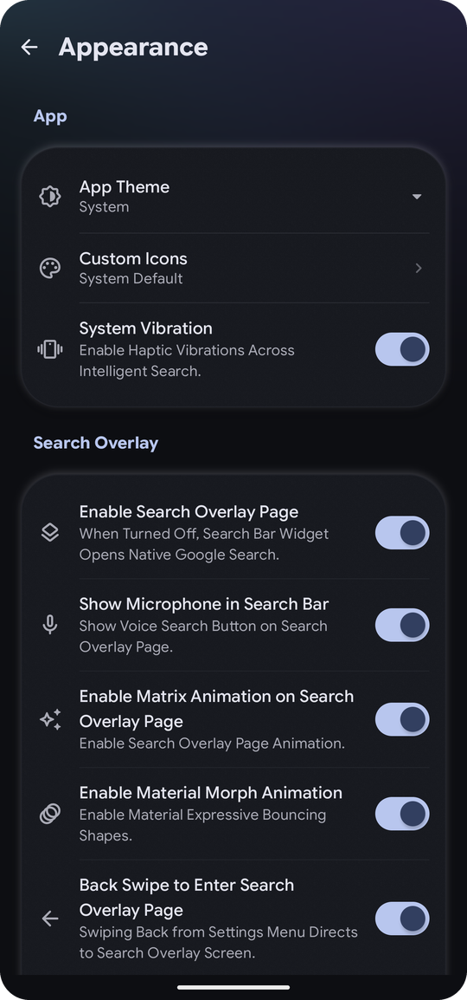<br/><sub><b>Appearance</b></sub></td>
    <td align="center" valign="top">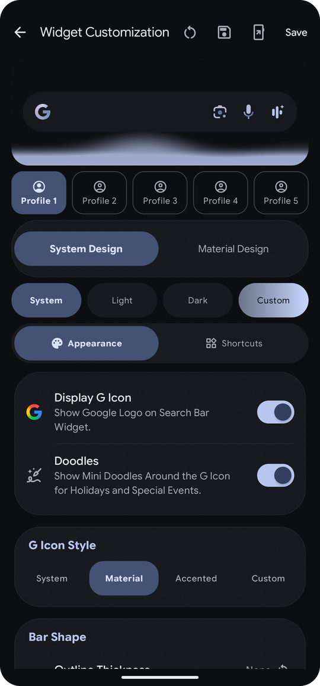<br/><sub><b>Widget Customization</b></sub></td>
  </tr>
</table>

</div>

---

## 🧭 Features

<table>
  <tr>
    <td width="50%" valign="top">
      <h3>🔍 Search everything</h3>
      <ul>
        <li>Apps across your personal, work and private space profiles, plus Android's settings pages.</li>
        <li>Contacts, notifications and files you pick through the system picker.</li>
        <li>Live web suggestions with pictures, and your recent searches, each of which can be turned off.</li>
        <li>Web shortcuts like <code>!yt</code>, <code>!w</code> or <code>!gh</code>, plus your own search engines.</li>
      </ul>
    </td>
    <td width="50%" valign="top">
      <h3>⚡ Instant answers and actions</h3>
      <ul>
        <li>A full calculator: functions, percentages ("20% off 59.99"), bitwise math and number bases, in your locale's format.</li>
        <li>Units, currencies, dates, time zones, definitions and the weather.</li>
        <li>Plain sentences become actions: timers, alarms, reminders, events, messages, calls and directions.</li>
        <li>Optional AI Answers with your own provider key: nothing is sent until you tap Ask.</li>
      </ul>
    </td>
  </tr>
  <tr>
    <td width="50%" valign="top">
      <h3>☀️ Discover</h3>
      <ul>
        <li>Your next event with when to leave, the rest of your day, the weather ahead and what's playing.</li>
        <li>Quick controls, battery and screen time, a word of the day, holiday countdowns and tomorrow.</li>
        <li>Cards anywhere and any size, in Material shapes, with live widgets from your apps and website cards.</li>
        <li>Private cards stay covered until you tap them.</li>
      </ul>
    </td>
    <td width="50%" valign="top">
      <h3>🧠 Smart matching</h3>
      <ul>
        <li>Typo-tolerant, sound-alike and acronym matching: "spotfy" finds Spotify, "gps" finds Google Play Store.</li>
        <li>A best match ranked by how often and how recently you use things.</li>
        <li>Spelling suggestions, context-aware quick apps and clipboard suggestions.</li>
      </ul>
    </td>
  </tr>
  <tr>
    <td width="50%" valign="top">
      <h3>🎙️ Assistant and voice</h3>
      <ul>
        <li>Set it as your digital assistant, so the assistant gesture opens search.</li>
        <li>Voice search with a live listening animation, and the Voice Nebula widget shortcut.</li>
        <li>Google Lens one tap away.</li>
      </ul>
    </td>
    <td width="50%" valign="top">
      <h3>🏠 Widgets and launch points</h3>
      <ul>
        <li>Resizable System and Material search bar widgets, and a countdown widget.</li>
        <li>Color Studio, custom shortcuts and G icon styles, with a live preview and saved profiles.</li>
        <li>Animated mini doodles around the G on 71 holidays and special days.</li>
        <li>A Quick Settings tile, app shortcuts, a notification shortcut and a floating button.</li>
      </ul>
    </td>
  </tr>
  <tr>
    <td width="50%" valign="top">
      <h3>🎨 Make it yours</h3>
      <ul>
        <li>Material You colors, light and dark themes, and your wallpaper behind search.</li>
        <li>Blur, transparency and opacity controls, Material shapes and expressive motion.</li>
        <li>Icon packs, custom icons and haptic feedback.</li>
      </ul>
    </td>
    <td width="50%" valign="top">
      <h3>🛡️ Privacy first</h3>
      <ul>
        <li>All matching and ranking happen on the device.</li>
        <li>Contacts, calendar, notifications and files stay off until you allow them.</li>
        <li>Choose Tor Browser as your engine, and nothing goes out except through it.</li>
        <li>Hidden apps lock behind your fingerprint or face; backups are encrypted with a passkey or passphrase.</li>
      </ul>
    </td>
  </tr>
</table>

On Android 16 and later, on-device assistants can use App Functions to search your apps and run calculations; hidden
apps are never shared, and contact search for assistants stays off until you turn it on.

Read exactly what is sent where in the [privacy policy](PRIVACY_POLICY.md).

---

## 📲 Install

- **Google Play:** [Intelligent Search](https://play.google.com/store/apps/details?id=com.pixel.intelligentsearch)
- **APK:** the latest signed build is on the [Releases page](https://github.com/Peacetothemountain/Intelligent-Search/releases/latest).

Requires Android 12 or later. Built for Pixel phones and tablets, and works on any Android phone.

---

## 🏗️ Architecture

```
app/src/main/java/com/pixel/intelligentsearch
├── feature
│   ├── search        The search overlay: results, answers, voice, quick apps
│   │   └── today     Discover: the freeform card page, its shapes, app widget and website cards
│   ├── settings      Settings, Widget Customization, backup and restore, setup checklist
│   ├── widget        Search bar and countdown widgets, the Quick Settings tile, Voice Nebula
│   ├── voice         Assistant service, speech recognition, dictation
│   ├── launch        Notification shortcut and floating button
│   └── appfunctions  App Functions for on-device assistants
├── core
│   ├── search        Radix tree index, fuzzy and phonetic matching, ranking, calculator, intent parser
│   ├── answers       Definitions, weather and other instant answers
│   ├── ai            AI Answers: providers, requests and streaming
│   ├── data          Settings store, device sources, Room history database, web suggestions
│   ├── backup        Encrypted backups, automatic backup and restore
│   ├── security      Network policy, biometric gate, safe web launches
│   ├── net           The one HTTPS client
│   ├── system        Assistant and search roles, system toggles, Direct Boot
│   └── theme, ui     Material You theming, AGSL shaders, shared components
└── di                Hilt modules
```

Built with Kotlin, Jetpack Compose, Material 3 Expressive, Material You dynamic color, AGSL shaders, Hilt and Room.

---

## 🛠️ Build from source

**You need:** Android Studio with Android Gradle Plugin 9.4, JDK 17, and the Android 17 SDK (compile and target SDK
37; minimum SDK 31).

```bash
git clone https://github.com/Peacetothemountain/Intelligent-Search.git
cd Intelligent-Search

./gradlew assembleDebug        # debug build
./gradlew assembleRelease      # release build
./gradlew lintDebug testDebugUnitTest   # lint, unit, characterization and screenshot tests
```

A release build is signed when `release.keystore` is in the project root and `RELEASE_STORE_PASSWORD`,
`RELEASE_KEY_ALIAS` and `RELEASE_KEY_PASSWORD` are set in `local.properties` or the environment; otherwise Gradle
writes `app-release-unsigned.apk`. Release builds are never signed with the debug key.

The tests run on Robolectric and Roborazzi, so no device is needed. Screenshot references live in
`app/src/test/screenshots`; after an intended visual change, record them again with
`./gradlew testDebugUnitTest -Proborazzi.record=true`.

---

## 📦 Continuous integration and releases

GitHub Actions runs on GitHub-hosted runners, with every action pinned to a commit SHA.

- **`ci.yml`** runs lint, every test (screenshot comparisons included) and a release build on each push to `dev` and each pull
  request to `main` or `dev`. `main` is protected: a commit reaches it only after this check passes.
- **`release.yml`** builds and signs the APK for a `v<version>-<code>` tag on `main`, and publishes it with its R8
  mapping as a GitHub release.

---

## ⚖️ License

Intelligent Search is open source under the **[Apache License 2.0](LICENSE)**. Copyright 2026 NG Designs.

Third-party material the app includes, and its terms, is listed in [`NOTICE`](NOTICE): the Google Sans Flex font (SIL
Open Font License 1.1) and the Android robot (Creative Commons Attribution 3.0).

- **Privacy policy:** [`PRIVACY_POLICY.md`](PRIVACY_POLICY.md)
- **Report a security issue:** [`SECURITY.md`](SECURITY.md)

---

## 🏷️ Trademarks

**Intelligent Search** is an independent app by **NG Designs**. It is not affiliated with, sponsored by or endorsed by
Google LLC or any other company named here. The Apache License does not grant permission to use the Intelligent Search
or NG Designs names or logos (section 6).

Android, Google, Google Pixel, Google Play, the Google Play logo, Google Lens, Google Sans, Chrome, YouTube and
Material You are trademarks of Google LLC. The Android robot is reproduced or modified from work created and shared by
Google and used according to terms described in the Creative Commons 3.0 Attribution License. Tor is a trademark of
The Tor Project, Inc. DuckDuckGo is a trademark of Duck Duck Go, Inc. Bing is a trademark of Microsoft Corporation.
Wikipedia is a trademark of the Wikimedia Foundation. All other product names, logos and brands are the property of
their respective owners and are used only to identify them.

Web searches go directly from your phone to the search engine you choose (Google, DuckDuckGo, Bing, Tor Browser or
your own search address).

---

<div align="center">
<sub>Copyright 2026 NG Designs · Licensed under the Apache License 2.0</sub>
</div>
