<div align="center">


**A Pixel-inspired search overlay, assistant and home screen widget for Android**

[](https://github.com/Peacetothemountain/Intelligent-Search/actions/workflows/ci.yml)
[](https://github.com/Peacetothemountain/Intelligent-Search/releases/latest)
[](https://developer.android.com/about/versions)
[](LICENSE)

<a href="https://play.google.com/store/apps/details?id=com.pixel.intelligentsearch"></a>

</div>

---

## 🌟 Overview

**Intelligent Search** brings Pixel-style search to any Android 12+ phone or tablet. One search bar finds your apps,
shortcuts, contacts, calendar, files and the web, answers calculations and conversions instantly, and turns plain
sentences like *"timer 10 minutes"* into actions. It can replace the default digital assistant, lives on your home
screen as a fully customizable widget, and does all of its matching on the device.

Built with Jetpack Compose, Material 3 Expressive, Material You dynamic color and AGSL GPU shaders.

---

## 📸 Screenshots

<div align="center">
<table>
  <tr>
    <td align="center" valign="top">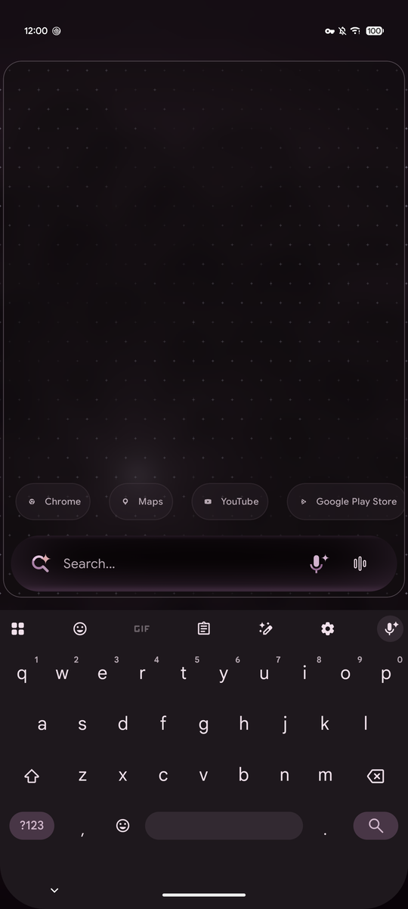<br/><sub><b>Search overlay</b></sub></td>
    <td align="center" valign="top">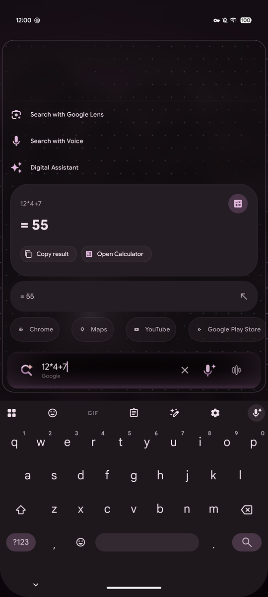<br/><sub><b>Instant calculator</b></sub></td>
    <td align="center" valign="top">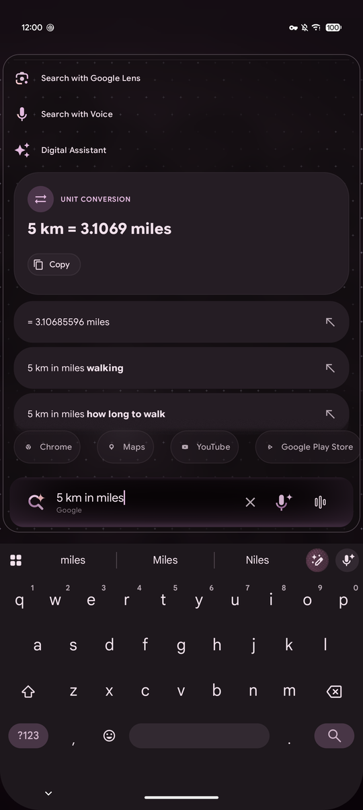<br/><sub><b>Unit conversion</b></sub></td>
    <td align="center" valign="top">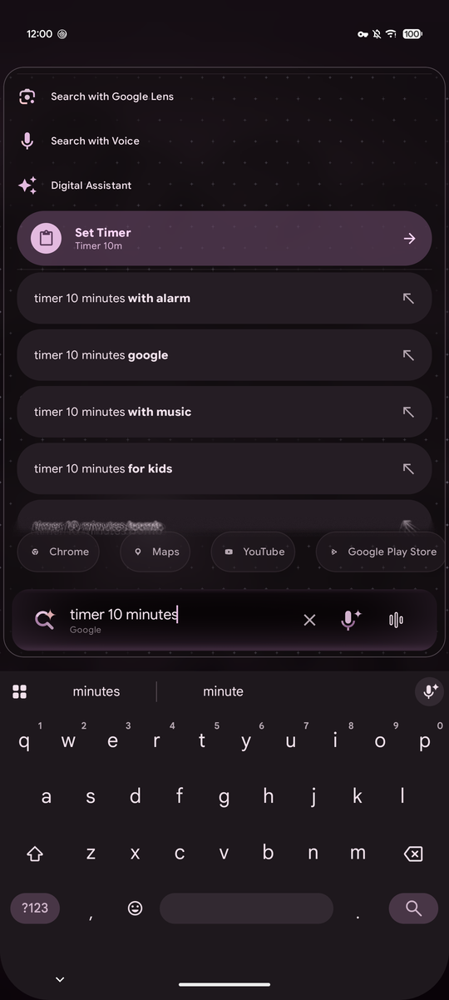<br/><sub><b>Quick actions</b></sub></td>
  </tr>
  <tr>
    <td align="center" valign="top">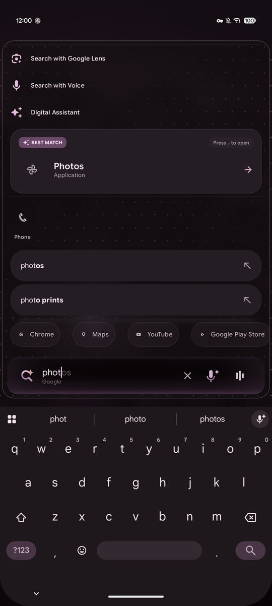<br/><sub><b>Best match</b></sub></td>
    <td align="center" valign="top">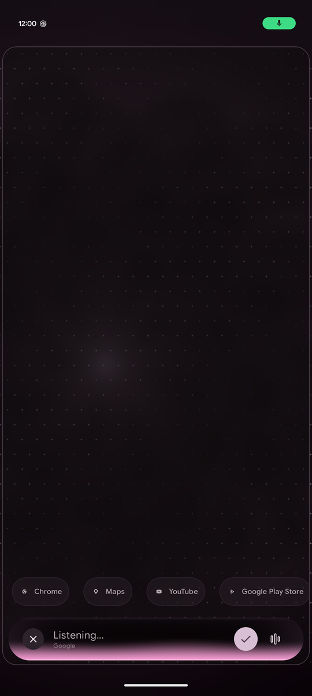<br/><sub><b>Voice search</b></sub></td>
    <td align="center" valign="top">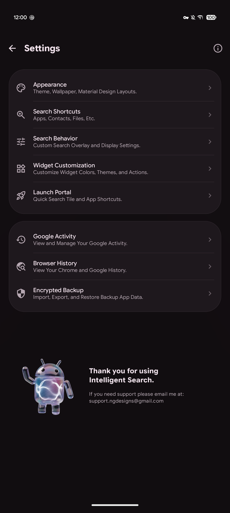<br/><sub><b>Settings</b></sub></td>
    <td align="center" valign="top">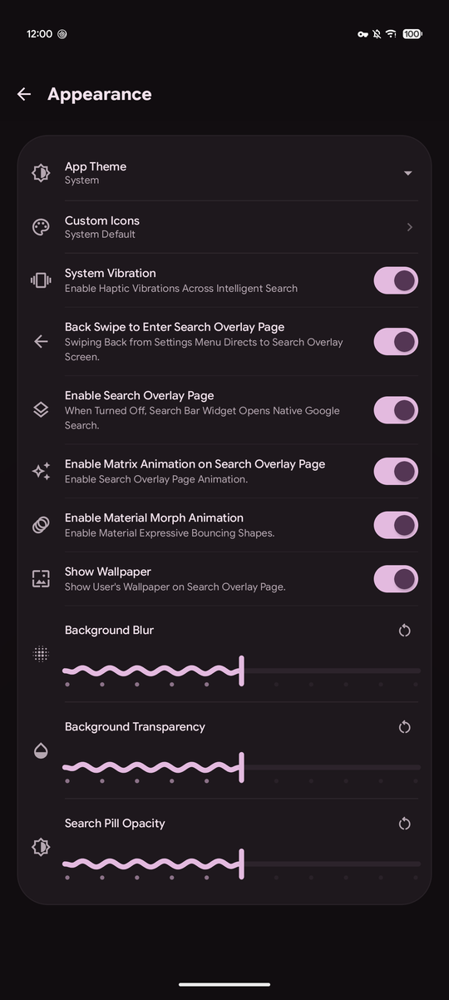<br/><sub><b>Appearance</b></sub></td>
  </tr>
  <tr>
    <td align="center" valign="top">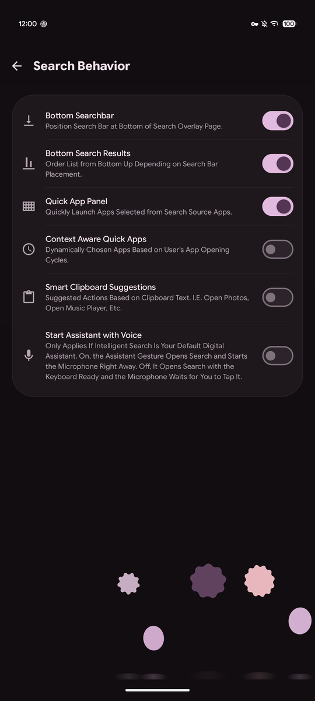<br/><sub><b>Search behavior</b></sub></td>
    <td align="center" valign="top">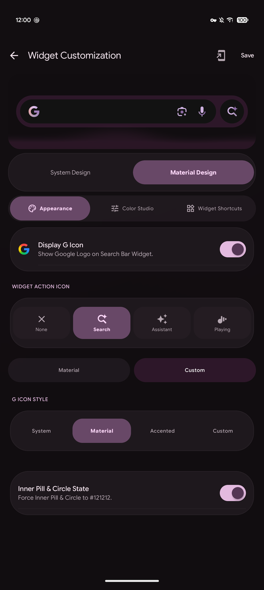<br/><sub><b>Widget customization</b></sub></td>
    <td align="center" valign="top">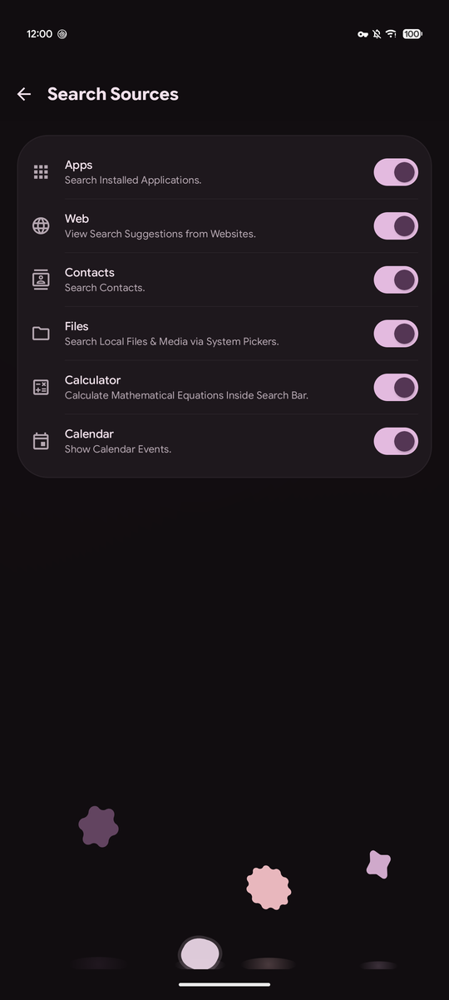<br/><sub><b>Search sources</b></sub></td>
    <td></td>
  </tr>
</table>
</div>

---

## ✨ Features

<table>
  <tr>
    <td width="50%" valign="top">
      <h3>🔍 Search everything</h3>
      <ul>
        <li>Apps across your personal, work and private space profiles, plus their app shortcuts.</li>
        <li>Contacts, calendar events and files you choose through the system picker.</li>
        <li>Live web suggestions and your previous searches, each of which can be turned off.</li>
        <li>Quick web shortcuts such as <code>!yt</code>, <code>!w</code> or <code>!gh</code>, plus your own custom search engines.</li>
      </ul>
    </td>
    <td width="50%" valign="top">
      <h3>⚡ Instant answers and actions</h3>
      <ul>
        <li>A full calculator: functions, percentages, bitwise maths and number bases.</li>
        <li>Unit conversion and the time in other places.</li>
        <li>Plain sentences become actions: timers, alarms, reminders, calendar events, messages, calls and directions.</li>
        <li>Toggle Wi-Fi, Bluetooth, the flashlight or airplane mode, and set the volume, right from the results.</li>
      </ul>
    </td>
  </tr>
  <tr>
    <td width="50%" valign="top">
      <h3>🧠 Smart matching</h3>
      <ul>
        <li>Typo-tolerant, sound-alike and acronym matching, so "spotfy" finds Spotify and "gps" finds Google Play Store.</li>
        <li>Spelling suggestions, and a best match ranked by how often and how recently you use things.</li>
        <li>Optional context-aware quick apps and clipboard suggestions.</li>
      </ul>
    </td>
    <td width="50%" valign="top">
      <h3>🎙️ Assistant and voice</h3>
      <ul>
        <li>Can be set as the default digital assistant, so the assistant gesture opens search.</li>
        <li>Built-in voice search with a live listening animation.</li>
        <li>Google Lens and assistant shortcuts one tap away.</li>
      </ul>
    </td>
  </tr>
  <tr>
    <td width="50%" valign="top">
      <h3>🏠 Widgets and launch points</h3>
      <ul>
        <li>Resizable System Design and Material Design search bar widgets.</li>
        <li>Color Studio, custom action buttons and G icon styles, with a live preview.</li>
        <li>Animated mini doodles around the G on 34 holidays and special days, drawn on your phone; tap one to search for the day.</li>
        <li>A Quick Settings tile and launcher app shortcuts; the widget keeps working before first unlock.</li>
      </ul>
    </td>
    <td width="50%" valign="top">
      <h3>🎨 Make it yours</h3>
      <ul>
        <li>Material You colors, light and dark themes, and your wallpaper behind the overlay.</li>
        <li>Background blur, transparency and pill opacity controls.</li>
        <li>Icon packs and custom icons, animated backgrounds and haptic feedback.</li>
      </ul>
    </td>
  </tr>
  <tr>
    <td width="50%" valign="top">
      <h3>🛡️ Privacy first</h3>
      <ul>
        <li>All matching and ranking happens on the device.</li>
        <li>Contacts, calendar and files are off until you allow them.</li>
        <li>Hidden apps can be locked behind your fingerprint or face.</li>
        <li>Nothing goes to Google's cloud backup; your own backups are encrypted with a passphrase.</li>
      </ul>
    </td>
    <td width="50%" valign="top">
      <h3>🤖 Works with AI agents</h3>
      <ul>
        <li>On Android 16 and later, on-device assistants can use App Functions to search your apps and run calculations.</li>
        <li>Hidden apps are never returned, and contact search for assistants is off until you turn it on.</li>
      </ul>
    </td>
  </tr>
</table>

---

## 🏗️ Architecture

```
app/src/main/java/com/pixel/intelligentsearch
├── feature
│   ├── search        Search overlay: SearchActivity, SearchViewModel, results, voice, quick apps
│   ├── settings      Settings screens, widget editor, backup and restore, setup checklist, tutorial
│   ├── widget        Search bar widgets, Quick Settings tile, widget updates
│   ├── voice         Assistant (VoiceInteractionService), speech recognition, dictation
│   └── appfunctions  App Functions offered to on-device agents
├── core
│   ├── search        Radix tree index, fuzzy and phonetic matching, ranking, calculator, intent parser
│   ├── data          Settings store, device sources, Room history database, web suggestions
│   ├── backup        Encrypted backup, auto backup and restore
│   ├── security      Biometric gate, safe web launches, custom search URL checks
│   ├── system        Assistant role, system toggles, Direct Boot
│   └── theme, ui     Material You theming, shaders, shared components
└── di                Hilt modules
```

---

## 🛠️ Building from source

**Requirements:** a current Android Studio that supports Android Gradle Plugin 9.4, JDK 17, compile and target SDK 37
(Android 17), minimum SDK 31 (Android 12).

```bash
git clone https://github.com/Peacetothemountain/Intelligent-Search.git
cd Intelligent-Search

# Debug build
./gradlew assembleDebug

# Release build
./gradlew assembleRelease
```

A release build is signed when `release.keystore` is in the project root and `RELEASE_STORE_PASSWORD`,
`RELEASE_KEY_ALIAS` and `RELEASE_KEY_PASSWORD` are set in `local.properties` or the environment. The APK is written to
`app/build/outputs/apk/release/app-release.apk`. Without them Gradle produces `app-release-unsigned.apk`; release
builds are never signed with the debug key.

### Tests

```bash
./gradlew lintDebug testDebugUnitTest
```

This runs lint and the unit, characterization and screenshot tests (Robolectric and Roborazzi); no device is needed.
Screenshot references live in `app/src/test/screenshots`; after an intended visual change, re-record them with
`./gradlew testDebugUnitTest -Proborazzi.record=true`.

---

## 📦 Continuous integration and releases

GitHub Actions runs on GitHub-hosted runners, with every action pinned to a commit SHA.

- **`ci.yml`** runs lint, every test (including the screenshot comparisons) and a release build on each push and pull
  request to `main` and `dev`. `main` is protected: a commit can only reach it once this check has passed.
- **`release.yml`** builds a signed APK for each `v*` tag and publishes it as a GitHub release.

Download the latest APK from the [Releases page](https://github.com/Peacetothemountain/Intelligent-Search/releases/latest),
or install from [Google Play](https://play.google.com/store/apps/details?id=com.pixel.intelligentsearch).

---

## ⚖️ License

Intelligent Search is open source software licensed under the **Apache License, Version 2.0**.

- **Full license text:** [`LICENSE`](LICENSE)
- **Privacy policy:** [`PRIVACY_POLICY.md`](PRIVACY_POLICY.md)
- **Reporting a security issue:** [`SECURITY.md`](SECURITY.md)

---

## 🏷️ Trademarks & Legal Disclaimer

Android, Google, Google Pixel, Google Play, and the Google Play logo are registered trademarks of **Google LLC**.

- **Intelligent Search** is an independent software application developed by **NG Designs**.
- This application and repository are not affiliated with, sponsored by, or endorsed by Google LLC.
- All web search queries and search engine options (Google, DuckDuckGo, Bing, or Custom Search URLs) execute directly via standard web intents to their respective providers.

---

Copyright (c) 2026 **NG Designs**. All Rights Reserved.
